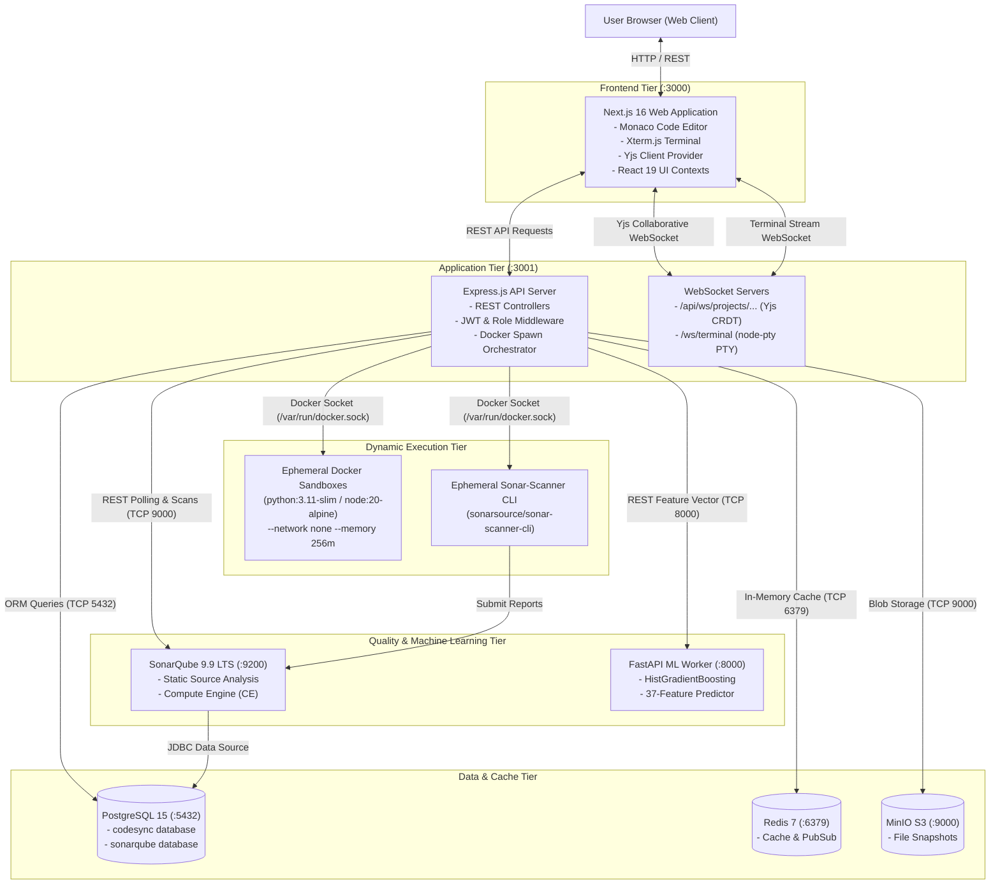
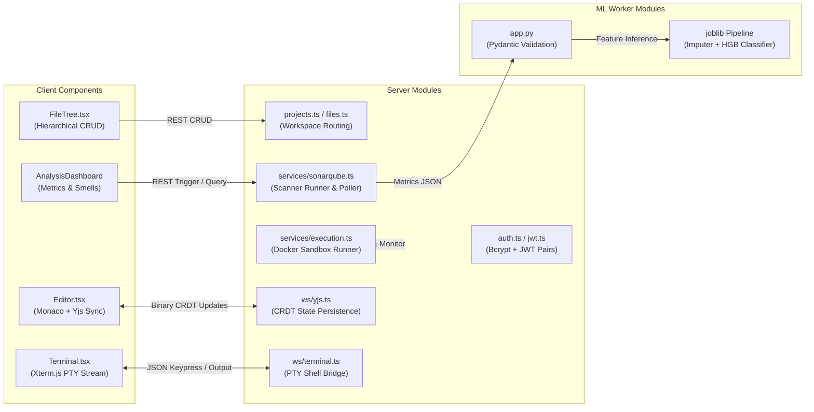
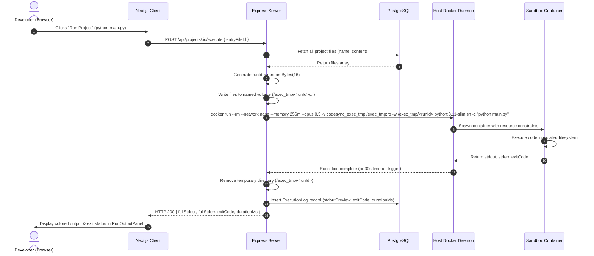
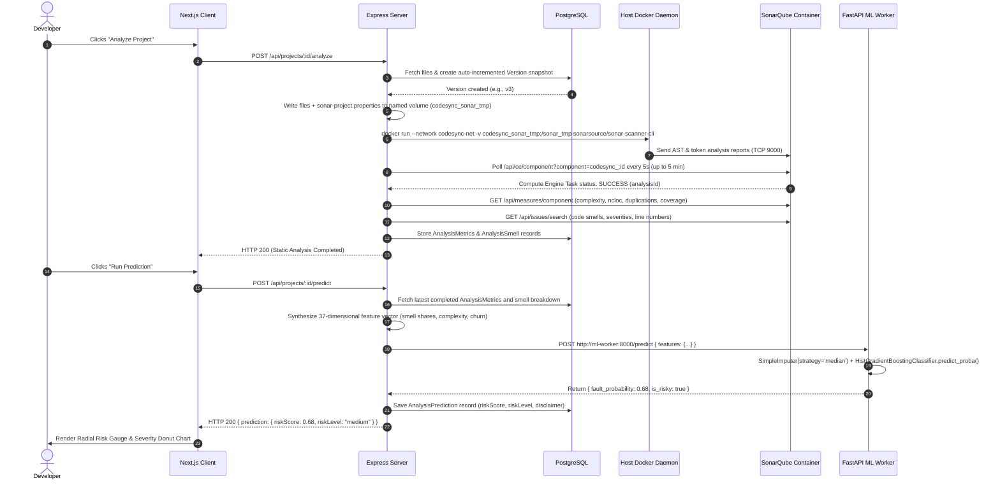
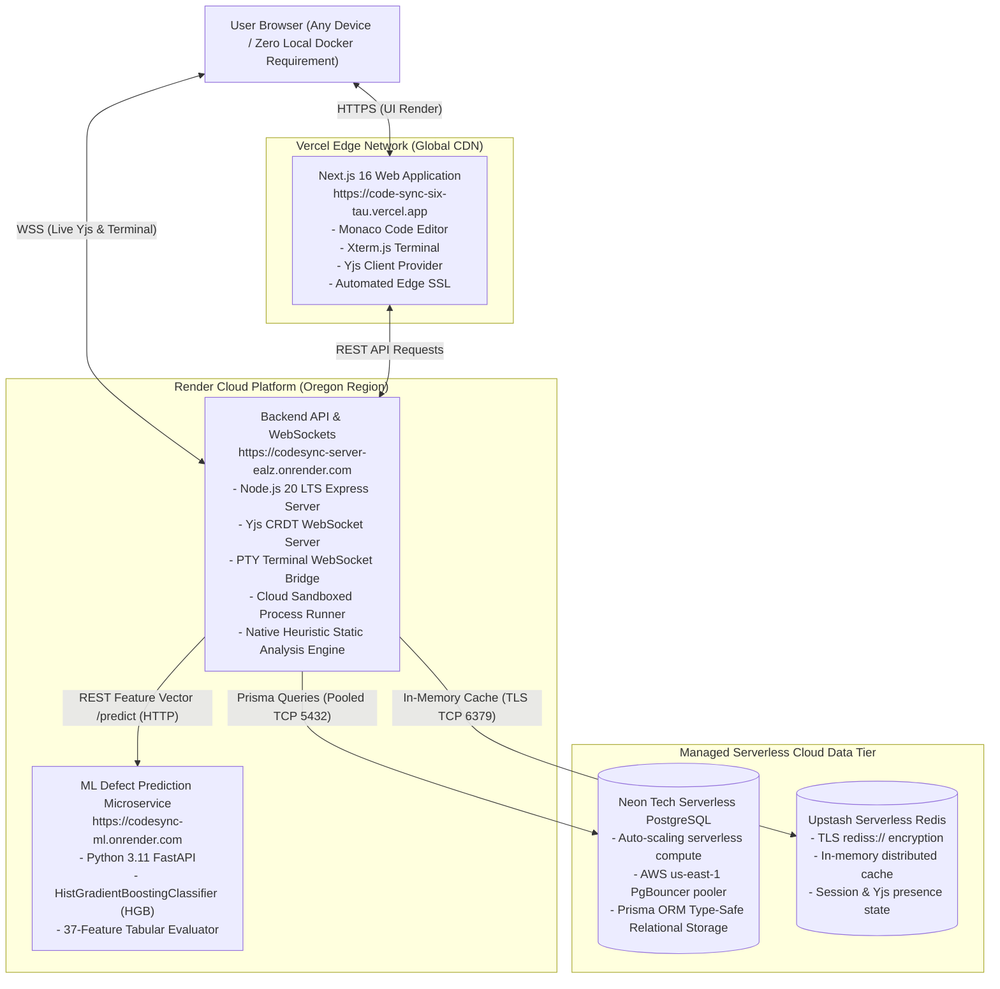
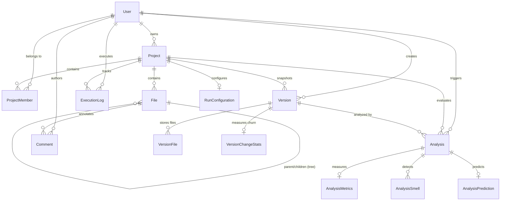

# CodeSync: Comprehensive Capstone Project Technical Reference & Defense Manual

> **Document Classification:** Final Capstone Project Technical Study & Viva Preparation Guide  
> **Project Title:** CodeSync — Collaborative Code Development & Intelligent Defect-Risk Analysis Platform  
> **Target Audience:** Project Review Board, Technical Evaluators, Capstone Defense Panel, and Core Developers  
> **Repository Path:** `d:\CodeSync`

---

## Table of Contents
1. [Complete Project Overview](#1-complete-project-overview)
2. [Technology Stack – Detailed Technical Explanation](#2-technology-stack--detailed-technical-explanation)
3. [Project Architecture and System Design](#3-project-architecture-and-system-design)
4. [Complete Project Structure and Directory Breakdown](#4-complete-project-structure-and-directory-breakdown)
5. [Complete Code Explanation – File by File](#5-complete-code-explanation--file-by-file)
6. [Complete Application Workflows](#6-complete-application-workflows)
7. [Database Design and Data Management](#7-database-design-and-data-management)
8. [API Design and Backend Implementation](#8-api-design-and-backend-implementation)
9. [Security, Authentication, and Authorization](#9-security-authentication-and-authorization)
10. [Core Algorithms and Technical Logic](#10-core-algorithms-and-technical-logic)
11. [Testing, Debugging, and Error Handling](#11-testing-debugging-and-error-handling)
12. [Deployment, Container Orchestration, and Execution](#12-deployment-container-orchestration-and-execution)
13. [Technical Decisions, Trade-Offs, and Justifications](#13-technical-decisions-trade-offs-and-justifications)
14. [Current Limitations and Future Roadmap](#14-current-limitations-and-future-roadmap)
15. [Final Capstone Review – Viva and Panel Preparation (16 Question Categories)](#15-final-capstone-review--viva-and-panel-preparation)
16. [Presentation & Defense Scripts (30s, 1m, 3–5m)](#16-presentation--defense-scripts)
17. [Technical Glossary and Concept Index](#17-technical-glossary-and-concept-index)
18. [Final Review Room Readiness Checklist](#18-final-review-room-readiness-checklist)

---

## 1. Complete Project Overview

### 1.1 Executive Summary & Problem Formulation
In modern distributed software engineering, teams encounter three critical frictions in their daily development loop:
1. **The Collaboration Friction:** Developers write code in isolated local IDEs (VS Code, JetBrains) and collaborate asynchronously through version control commits and pull requests. Synchronous pair programming or mob programming typically relies on passive video screen sharing, which degrades interactivity, prevents simultaneous typing, and wastes bandwidth.
2. **The Delayed Quality Feedback Loop:** Code quality analysis, linting, and vulnerability scanning are almost universally deferred to automated CI/CD pipelines (e.g., GitHub Actions, Jenkins). Consequently, engineers only discover maintainability issues, code smells, high cyclomatic complexity, or security vulnerabilities minutes or hours after writing the code, leading to costly context switching.
3. **The Absence of Empirical Defect Risk Forecasting:** Traditional static analysis tools report rule-based heuristic violations ("code smells" such as long parameter lists or cognitive complexity warnings), but they cannot provide an empirical probability of whether a specific changeset is likely to induce a runtime defect or bug into production.

**CodeSync** solves these challenges by unifying **real-time collaborative code editing**, **sandboxed isolated in-browser code execution**, **on-demand static code quality analysis**, and **machine-learning-powered defect-risk prediction** into a single cohesive web-based software engineering platform.

### 1.2 Core Objectives
* **Sub-50ms Synchronous Collaborative Editing:** Implement conflict-free, multi-user document synchronization with live cursor tracking and awareness indicators using Conflict-free Replicated Data Types (CRDTs).
* **Polyglot Sandboxed Code Execution:** Execute untrusted client code across multiple programming languages (Python, JavaScript/Node.js, TypeScript, Java) inside isolated OS-level containers with strict memory, CPU, PID, and network limits.
* **Integrated Static Code Auditing:** Provide one-click SonarQube analysis within the workspace, extracting 8 core code metrics and pinpointing specific code smells mapped down to file names and line numbers.
* **Empirical Fault-Risk Intelligence:** Formulate a 37-dimensional software metric feature vector from codebase properties and evaluate it against pre-trained machine learning classifiers (`HistGradientBoostingClassifier`, `RandomForestClassifier`, `LogisticRegression`) to deliver an interpretable defect risk probability ($[0.0, 1.0]$) before code is merged.
* **Zero-Host-Dependency Portability:** Orchestrate all seven application services via Docker Compose, enabling deterministic reproduction on any machine with `docker compose up --build`.

### 1.3 Intended Users & Real-World Use Cases
* **Distributed Engineering Teams & Pair Programmers:** Real-time cooperative feature implementation, remote debugging, and shared terminal reviews without third-party screen sharing.
* **Academic Institutions & Coding Interview Platforms:** Controlled polyglot execution environments with automated quality profiling and plagiarism-resistant snapshot histories.
* **Quality Assurance Leads & Engineering Managers:** Objective, data-driven code health metrics and statistical risk scores to triage code reviews before production deployments.

---

## 2. Technology Stack – Detailed Technical Explanation

| Layer / Technology | Version / Image | Implementation Location | Technical Role & Mechanism | Justification & Alternatives Evaluated |
| :--- | :--- | :--- | :--- | :--- |
| **Frontend Framework** | Next.js 16.0 (React 19) | `client/` | App Router-based single-page application with hybrid SSR/client components, dynamic routing, and layout nesting. | **Selected:** React 19 concurrent features + Next.js App Router for optimal layout caching and route transitions.<br>**Alternative:** Vite + React SPA lacks built-in route caching, server pre-rendering of meta tags, and structured layout isolation. |
| **Code Editor** | Monaco Editor (`@monaco-editor/react` v4.7) | `client/src/components/Editor.tsx` | Browser-based code editing engine powering VS Code; syntax highlighting, tokenization, line numbers, folding, custom dark theme. | **Selected:** Industry gold standard; handles 10,000+ lines via virtualized DOM.<br>**Alternative:** CodeMirror 6 or Ace Editor have less complete language tooling, fewer VS Code keyboard shortcuts, and less native theme parity. |
| **Real-Time CRDT Engine** | Yjs v13.6 + `y-websocket` | `client/src/components/Editor.tsx`, `server/src/ws/yjs.ts` | Conflict-free Replicated Data Type engine for peer-to-peer and client-server document convergence without central locks. | **Selected:** Mathematically guarantees eventual consistency without operational transformation (OT) server bottlenecks.<br>**Alternative:** Operational Transformation (OT) requires a central sequencer and is brittle under high network latency or offline reconnects. |
| **Terminal Emulator** | Xterm.js v5.5 (`@xterm/xterm`) | `client/src/components/Terminal.tsx` | VT100/xterm-compliant terminal emulator rendering ANSI color escapes, supporting pseudo-terminal resize, and streaming keystrokes. | **Selected:** VS Code's terminal core; robust PTY escape-code handling.<br>**Alternative:** Plain text `<div>` or `<textarea>` cannot parse VT100 escape codes (colors, cursor positioning, clear screen). |
| **Backend Runtime** | Node.js 20 LTS + Express.js v4.21 | `server/src/index.ts` | Asynchronous event-driven HTTP REST API server and WebSocket upgrade handler. | **Selected:** Non-blocking I/O handles high concurrent persistent WebSocket connections with minimal memory overhead.<br>**Alternative:** Python Django/Flask (blocking worker models require large process pools; WebSockets require separate ASGI servers). |
| **Database & ORM** | PostgreSQL 15 + Prisma ORM v5.22 | `server/prisma/schema.prisma` | Relational storage for users, projects, files, immutable versions, metrics, and logs. Prisma generates type-safe database queries. | **Selected:** ACID transaction guarantees, JSONB column support for flexible metadata, and referential integrity.<br>**Alternative:** MongoDB lacks strict relational foreign keys; raw SQL lacks compile-time TypeScript type safety. |
| **Cache & Queue Backbone** | Redis 7 Alpine | `docker-compose.yml` (`redis:6379`) | In-memory key-value cache and event broker. | **Selected:** Sub-millisecond latency for ephemeral session state and rapid cache invalidation.<br>**Alternative:** Memcached lacks built-in persistence and pub/sub data structures. |
| **Object Storage** | MinIO (RELEASE.2024) | `docker-compose.yml` (`minio:9000`) | S3-compatible local object storage for file snapshots and analysis artifacts. | **Selected:** Drop-in compatibility with AWS S3 SDK without incurring cloud expenses during local development.<br>**Alternative:** Direct local filesystem writes break multi-node container scalability. |
| **Static Code Analyzer** | SonarQube 9.9 LTS Community | `docker-compose.yml` (`sonarqube:9000`), `server/src/services/sonarqube.ts` | Industry-grade static analyzer for code smells, vulnerabilities, cyclomatic complexity, cognitive complexity, and lines of code. | **Selected:** Recognized enterprise standard with language-agnostic scanner plugins.<br>**Alternative:** ESLint / Flake8 / Checkstyle are fragmented per language; SonarQube unifies metrics across Python, Java, JS, and TS. |
| **ML Inference Service** | Python 3.11 + FastAPI + Uvicorn | `ml-worker/app.py` | Asynchronous microservice serving pre-trained scikit-learn models via REST endpoints (`/predict`, `/health`). | **Selected:** FastAPI generates OpenAPI specs, serializes via Pydantic, and handles high-throughput asynchronous inference.<br>**Alternative:** Flask is synchronous by default; TorchServe / Triton are unnecessarily heavyweight for tabular scikit-learn models. |
| **Machine Learning Models** | Scikit-Learn 1.3.2 (`HistGradientBoostingClassifier`, `RandomForestClassifier`, `LogisticRegression`) | `ml-worker/models/v1.0.0/` | Tabular machine learning classifiers trained on 47,162 software engineering commits to predict binary fault induction. | **Selected:** `HistGradientBoostingClassifier` natively handles missing values (NaNs) via histogram binning and achieved the highest PR-AUC (0.4159) on temporal validation splits. |
| **Container Sandboxing Engine** | Docker Engine (via Docker-in-Docker socket `/var/run/docker.sock`) | `server/src/services/execution.ts` | Ephemeral container runner with `--network none`, `--memory 256m`, `--cpus 0.5`, `--pids-limit 64`, and named volume mounts. | **Selected:** Kernel-level namespaces (cgroups, PID, network) guarantee untrusted user code cannot compromise the host system.<br>**Alternative:** Node `vm2` or `worker_threads` do not isolate system calls and are notoriously vulnerable to sandbox escape exploits. |
| **Cloud Frontend Deployment** | Vercel Edge Network | Live: `https://code-sync-six-tau.vercel.app` | Global edge distribution for Next.js App Router with automatic HTTPS, Brotli compression, and zero-configuration CI/CD. | **Selected:** Native Next.js first-party platform with optimal route caching and instantaneous edge cold-starts.<br>**Alternative:** Self-hosted Nginx container requires manual SSL rotation and lack of edge geolocation caching. |
| **Cloud Microservices & API** | Render Cloud Web Services | Live: `https://codesync-server-ealz.onrender.com` & `https://codesync-ml.onrender.com` | Host for Node.js Express API, WebSocket servers, and FastAPI Python ML inference microservice. | **Selected:** Unified blueprint management (`render.yaml`), automatic Git-triggered deployments, and native Linux runtime support.<br>**Alternative:** AWS EC2 requires high operational overhead; Heroku retired free-tier deployments. |
| **Cloud Database (Serverless)** | Neon Tech Serverless PostgreSQL 15 | Live: `ep-old-feather-bb6ud4jc-pooler.c-15.us-east-1.aws.neon.tech` | Serverless PostgreSQL with auto-scaling compute, built-in connection pooler (PgBouncer), and separated cloud storage. | **Selected:** Instant connection pooling for high-concurrency Prisma ORM queries without database connection exhaustion.<br>**Alternative:** Local PostgreSQL container requires persistent host storage and cannot scale dynamically across cloud regions. |
| **Cloud Cache (Serverless)** | Upstash Serverless Redis | Live: `cunning-fish-224777.upstash.io:6379` | Managed serverless Redis over TLS (`rediss://`) for distributed session caching and WebSocket presence coordination. | **Selected:** Zero-maintenance serverless billing; native REST & TLS socket compatibility.<br>**Alternative:** Redis Cloud requires fixed monthly instance costs even during idle periods. |

---

## 3. Project Architecture and System Design

### 3.1 High-Level Architecture Diagram
The system follows a containerized microservices and event-driven architecture organized under an internal Docker bridge network (`codesync_codesync-net`).



### 3.2 Component Architecture Diagram
Each tier maintains explicit boundaries, responsibilities, and data contracts:



### 3.3 Data-Flow Diagram (Code Execution Pipeline)
The following sequence details how client code moves from the editor to sandboxed execution and returns stdout/stderr to the browser:



### 3.4 Data-Flow Diagram (Static Analysis & ML Defect Prediction)



### 3.5 Multi-Cloud Serverless Production Topology (Vercel + Render + Neon + Upstash)
In addition to local Docker Compose orchestration, CodeSync is deployed to a 100% cloud-native architecture that requires **zero local Docker daemon dependencies**:



---

## 4. Complete Project Structure and Directory Breakdown

```
d:\CodeSync\
├── .dockerignore                          # Excludes node_modules, .git, .next, and logs from root docker context
├── .env                                   # Active environment variable file (secrets, URLs, database credentials)
├── .env.example                           # Canonical template defining all mandatory environment keys
├── architecture_overview.md               # High-level architecture briefing document
├── docker-compose.yml                     # Master 7-service orchestration configuration
├── README.md                              # Repository overview and quickstart guide
│
├── docker/                                # Supporting database and container initialization scripts
│   └── init-sonar-db.sql                  # PostgreSQL entrypoint SQL: creates dedicated 'sonarqube' database
│
├── client/                                # Next.js 16 (React 19) Frontend Application
│   ├── Dockerfile                         # Multi-stage production build (standalone Next.js runner)
│   ├── .dockerignore                      # Prevents local .next and node_modules leakage into image
│   ├── next.config.ts                     # Next.js compiler settings and environment bindings
│   ├── package.json                       # Frontend dependencies (@monaco-editor, @xterm, yjs, lucide-react)
│   ├── tsconfig.json                      # Strict TypeScript compiler configuration
│   └── src/
│       ├── app/                           # App Router directory
│       │   ├── layout.tsx                 # Root HTML shell wrapping Toast, Auth, and Tabs providers
│       │   ├── page.tsx                   # Interactive landing page (unauthenticated) & project dashboard (authenticated)
│       │   ├── globals.css                # Custom CSS design system (dark theme, variables, animations)
│       │   ├── providers.tsx              # Combined React context provider wrapper
│       │   ├── auth/
│       │   │   ├── layout.tsx             # Split-screen branding layout for authentication forms
│       │   │   ├── login/page.tsx         # User authentication form with JWT extraction
│       │   │   └── register/page.tsx      # User registration form with client-side password strength validation
│       │   └── projects/[id]/
│       │       ├── page.tsx               # Primary IDE workspace (Editor, FileTree, Terminal, Action Toolbar)
│       │       ├── activity/page.tsx      # Chronological audit log of project events and executions
│       │       ├── analysis/page.tsx      # Analysis dashboard (Radial risk gauge, metrics grid, smell breakdown)
│       │       ├── settings/page.tsx      # Member invitations, role toggles (team_lead/member), project deletion
│       │       └── versions/page.tsx      # Immutable snapshot timeline and file comparison viewer
│       ├── components/                    # Reusable UI components
│       │   ├── CommandPalette.tsx         # Ctrl+K modal for rapid project navigation and actions
│       │   ├── CreateProjectModal.tsx     # Project creation modal with language selector
│       │   ├── Editor.tsx                 # Monaco Editor paired with Yjs WebSocket client for CRDT sync
│       │   ├── FileTree.tsx               # Interactive tree view with file/folder creation and deletion
│       │   ├── RunConfigModal.tsx         # Custom execution command and working directory editor
│       │   ├── RunOutputPanel.tsx         # Terminal-styled output viewer for stdout, stderr, and execution duration
│       │   ├── StatusBar.tsx              # Bottom IDE status bar showing language, cursor line/col, and sync status
│       │   ├── TabBar.tsx                 # Multi-file tab navigation bar with close buttons
│       │   └── Terminal.tsx               # Xterm.js client connected via WebSocket to server PTY shell
│       ├── contexts/                      # React Context State Providers
│       │   ├── AuthContext.tsx            # User session, JWT storage in localStorage, and /api/auth/me validation
│       │   ├── TabsContext.tsx            # Multi-file tab state management (open, close, active tab)
│       │   └── ToastContext.tsx           # Global notification toast system (success, error, info)
│       └── lib/
│           └── api.ts                     # Centralized Fetch wrapper attaching Bearer tokens and handling 401s
│
├── server/                                # Express.js + TypeScript Backend Application
│   ├── Dockerfile                         # Node 20 Alpine container with Docker CLI and native PTY build tools
│   ├── docker-entrypoint.sh               # Container startup script: executes 'prisma db push' before starting server
│   ├── package.json                       # Backend dependencies (express, prisma, yjs, node-pty, bcryptjs, jsonwebtoken)
│   ├── tsconfig.json                      # Backend TypeScript configuration
│   ├── prisma/
│   │   └── schema.prisma                  # Comprehensive relational database schema (12 models)
│   └── src/
│       ├── index.ts                       # Application entrypoint: Express setup, HTTP server creation, WS mounting
│       ├── db.ts                          # Singleton PrismaClient instance with query logging
│       ├── config/
│       │   └── env.ts                     # Type-safe environment validation using Zod
│       ├── middleware/
│       │   ├── auth.ts                    # requireAuth middleware verifying Bearer JWTs
│       │   ├── error.ts                   # Centralized error handler converting AppError into structured JSON
│       │   └── role.ts                    # requireProjectRole & requireProjectPermission RBAC guards
│       ├── routes/
│       │   ├── index.ts                   # Master router aggregating sub-routers under /api
│       │   ├── auth.ts                    # /api/auth: register, login, refresh, logout, me, reset-password
│       │   ├── projects.ts                # /api/projects: CRUD operations and member invitations
│       │   ├── files.ts                   # /api/projects/:id/files: file/folder CRUD and tree generation
│       │   ├── comments.ts                # /api/projects/:id/files/:fileId/comments: line-level code commenting
│       │   ├── execution.ts               # /api/projects/:id/execute: sandboxed execution trigger and logs
│       │   ├── analysis.ts                # /api/projects/:id/analyze: SonarQube static scan trigger and smell queries
│       │   ├── predict.ts                 # /api/projects/:id/predict: ML feature vector compilation and worker bridge
│       │   └── runConfig.ts               # /api/projects/:id/run-config: custom build/run command persistence
│       ├── services/
│       │   ├── execution.ts               # Dynamic Docker container spawning with strict cgroup limits
│       │   └── sonarqube.ts               # Temporary workspace builder, Sonar-Scanner runner, and CE API poller
│       ├── utils/
│       │   ├── email.ts                   # Nodemailer SMTP transporter for invitations and verification emails
│       │   └── jwt.ts                     # JWT signing and verification utilities (access + refresh tokens)
│       └── ws/
│           ├── terminal.ts                # WebSocket server bridging node-pty pseudo-terminals with browser Xterm.js
│           └── yjs.ts                     # Custom WebSocket server implementing Yjs binary synchronization protocol
│
└── ml-worker/                             # Python 3.11 Machine Learning Microservice
    ├── Dockerfile                         # Python slim image exposing port 8000
    ├── docker-entrypoint.sh               # Volume seeder: copies pre-trained models from image seed to persistent volume
    ├── requirements.txt                   # FastAPI, Uvicorn, Scikit-Learn 1.3.2, Pandas 2.2.1, Joblib
    ├── app.py                             # FastAPI application serving /health and /predict endpoints
    ├── train_production_model.py          # Offline training pipeline on Technical Debt dataset (HGB, RF, LR)
    ├── inference_test.py                  # Standalone verification script testing synthetic feature vectors with NaNs
    └── models/v1.0.0/                     # Model artifacts directory
        ├── metadata.json                  # Training metadata, PR-AUC scores, and ordered 37-feature list
        ├── feature_bounds.json            # 1st and 99th feature percentiles for Out-Of-Distribution (OOD) checks
        ├── model_hgb.joblib               # Primary HistGradientBoostingClassifier pipeline
        ├── model_rf.joblib                # Secondary RandomForestClassifier pipeline
        └── model_lr.joblib                # Baseline LogisticRegression pipeline
```

---

## 5. Complete Code Explanation – File by File

### 5.1 Backend Server Modules

#### `server/src/index.ts`
* **Purpose:** Primary application bootstrap and server initialization.
* **Mechanism:**
  1. Loads environment variables via `dotenv.config()`.
  2. Creates an Express application and wraps it in a native Node `http.Server` via `createServer(app)`.
  3. Applies security middleware: `helmet` sets HTTP response security headers (CSP, HSTS, X-Frame-Options), restricting script, image, and WebSocket connection sources.
  4. Configures `cors` with explicit credentials support (`credentials: true`) matching `env.CORS_ORIGIN` (`http://localhost:3000`).
  5. Configures request parsing via `express.json({ limit: '5mb' })` and `express.urlencoded` to support large file uploads.
  6. Mounts REST endpoints under `/api` via `apiRouter`.
  7. Invokes `setupYjsWebsocket(httpServer)` and `setupTerminalWebsocket(httpServer)`. Both WebSocket servers hook into the `httpServer.on('upgrade')` event to intercept connection upgrades before Express processes them.

#### `server/src/ws/yjs.ts`
* **Purpose:** Custom server implementation of the Yjs binary collaborative synchronization protocol with PostgreSQL persistence.
* **Mechanism & Logic:**
  * **Document Cache:** Maintains an in-memory `Map<string, Y.Doc>()` keyed by `project:<projectId>:file:<fileId>`.
  * **Authentication on Upgrade:** Intercepts the HTTP `upgrade` request, parses the URL search parameters (`?token=<JWT>`), verifies the JWT via `verifyAccessToken()`, and queries the database (`prisma.projectMember.findUnique`) to verify that the requesting user belongs to the project. Unauthorized sockets are rejected immediately with `HTTP/1.1 401 Unauthorized`.
  * **Database Rehydration:** If a document is requested for the first time, `getOrCreateDoc()` checks `prisma.file.findUnique()`. If `yjsState` (a binary byte array) exists, it applies it via `Y.applyUpdate(ydoc, new Uint8Array(dbFile.yjsState))`. If only plaintext `content` exists, it seeds the Yjs text type `ydoc.getText('monaco').insert(0, dbFile.content)`.
  * **Debounced State Persistence:** Attaches a listener `ydoc.on('update', ...)` debounced by 1,000 milliseconds. When users type, changes are aggregated in memory. After 1 second of inactivity, the binary state update is serialized via `Y.encodeStateAsUpdate(ydoc)`, the plaintext string is extracted via `ydoc.getText('monaco').toString()`, and both are saved to PostgreSQL (`prisma.file.update`). Additionally, it touches `prisma.project.update({ data: { updatedAt: new Date() } })` so dashboard timestamps remain accurate.
  * **Binary Protocol Implementation:** Uses custom binary varuint decoders (`readVarUint`, `readVarUint8Array`) to handle Yjs Sync Step 1 (exchange state vectors), Sync Step 2 (apply missing updates), and Message Type 1 (awareness information like cursor positions).

#### `server/src/ws/terminal.ts`
* **Purpose:** WebSocket bridge providing interactive in-browser shell access.
* **Mechanism & Logic:**
  * **Dynamic Shell Detection:** Inspects the operating system. On Windows, it selects `powershell.exe`. On Linux/Docker, it executes `which bash` inside a `try/catch`. If available, it uses `bash`; otherwise, it falls back to `/bin/sh` (critical for minimal Alpine Linux containers where bash is absent).
  * **PTY Spawning:** Upon authorized connection, it invokes `pty.spawn(shell, [], { cols: 120, rows: 30, cwd: process.cwd(), env: process.env })` from `node-pty`.
  * **Bi-Directional Streaming:** PTY stdout is forwarded to the WebSocket client via `ptyProcess.onData(data => ws.send(JSON.stringify({ type: 'output', data })))`. In reverse, client keystrokes are received via `ws.on('message')` and written directly into `ptyProcess.write(parsed.data)`. Window resize events (`parsed.type === 'resize'`) trigger `ptyProcess.resize(cols, rows)`.

#### `server/src/services/execution.ts`
* **Purpose:** Polyglot isolated code execution runner.
* **Mechanism & Logic:**
  * **Language Dispatcher:** Maps project languages to runtime images:
    * `python` $\rightarrow$ `python:3.11-slim` (`python <entryFile>`)
    * `javascript` / `typescript` $\rightarrow$ `node:20-alpine` (`node <entryFile>`)
    * `java` $\rightarrow$ `openjdk:17-slim` (`java <entryFile>`)
  * **Volume Bridge Architecture:** When running inside Docker Compose, host paths inside the server container are invisible to the host Docker daemon. To overcome this, the server writes project files into a named Docker volume (`codesync_exec_tmp`) mounted at `/exec_tmp`. It creates a unique run folder `/exec_tmp/<runId>/`.
  * **Strict Sandboxing Parameters:** The container is executed with:
    * `--network none`: Complete network virtualization isolation (zero inbound/outbound internet access, preventing data exfiltration or malware downloads).
    * `--memory 256m`: Hard cgroup limit; out-of-memory processes are terminated by the kernel OOM killer rather than exhausting host RAM.
    * `--cpus 0.5`: Throttles CPU utilization to at most 50% of a single core, mitigating infinite loop denial-of-service.
    * `--pids-limit 64`: Hard limit on process table entries, completely mitigating fork bombs (`:(){ :|:& };:`).
    * `-v "codesync_exec_tmp:/exec_tmp:ro"`: Read-only volume mount, preventing the executed script from deleting or corrupting project files.
  * **Timeout Guard:** Uses `promisify(exec)` wrapped with a strict 30,000ms (30 second) execution timeout. If exceeded, the process is killed with exit code `124`.

#### `server/src/services/sonarqube.ts`
* **Purpose:** Automated static analysis orchestrator.
* **Mechanism & Logic:**
  * **Filesystem Setup:** Generates a 16-byte random run ID (`randomBytes(16).toString('hex')`) and writes project files into the shared named volume `codesync_sonar_tmp` mounted at `/sonar_tmp/<runId>`.
  * **Property Generation:** Synthesizes `sonar-project.properties`:
    ```properties
    sonar.projectKey=codesync_<projectId>
    sonar.projectName=Project_<projectId>
    sonar.projectVersion=1.0
    sonar.sources=.
    sonar.sourceEncoding=UTF-8
    sonar.language=<sonarLang>
    ```
  * **Containerized Scanner Execution:** Spawns `sonarsource/sonar-scanner-cli` connected to the internal network (`codesync_codesync-net`), mounting the named volume `-v "codesync_sonar_tmp:/sonar_tmp" -w "/sonar_tmp/<runId>"`. It authenticates to SonarQube using the global analysis token (`SONARQUBE_TOKEN`).
  * **Asynchronous Polling Loop:** SonarQube processes scans asynchronously in its Compute Engine (CE). The server polls `GET /api/ce/component?component=codesync_<projectId>` every 5 seconds for up to 5 minutes (60 iterations) using HTTP Basic Authentication (`admin:SONARQUBE_API_PASSWORD`).
  * **Metric & Issue Extraction:** Once status is `SUCCESS`, it queries `/api/measures/component` for 8 metrics (`complexity`, `cognitive_complexity`, `ncloc`, `coverage`, `duplicated_lines_density`, etc.) and `/api/issues/search?types=CODE_SMELL` for granular issue descriptions, severity ratings, and line numbers.

#### `server/src/routes/predict.ts`
* **Purpose:** Feature extraction engine and bridge to the Python ML worker.
* **Mechanism & Logic:**
  * Validates that the project language is Python (the current ML inference scope).
  * Queries the latest completed static analysis and extracts metrics from `AnalysisMetrics`.
  * Queries `AnalysisSmell` to compute severity distributions:
    $$\text{SEVERITY\_SHARE} = \frac{\text{Count}(\text{Severity})}{\text{Total Active Smells}}$$
  * Compiles an exact 37-dimensional feature dictionary matching the model schema (`COMPLEXITY`, `COGNITIVE_COMPLEXITY`, `ACTIVE_SMELLS`, `BLOCKER_SHARE`, `CRITICAL_SHARE`, `MAJOR_SHARE`, `MINOR_SHARE`, `LOG1P_LINES_CHANGED`, etc.).
  * Dispatches an HTTP `POST` to `http://ml-worker:8000/predict`.
  * Classifies the resulting probability score into qualitative tiers:
    * $\text{prob} > 0.7 \implies \text{High Risk}$
    * $0.4 < \text{prob} \le 0.7 \implies \text{Medium Risk}$
    * $\text{prob} \le 0.4 \implies \text{Low Risk}$
  * Persists the record to `prisma.analysisPrediction` along with an academic disclaimer detailing model origin and interpretability boundaries.

---

### 5.2 Machine Learning Worker (`ml-worker/`)

#### `ml-worker/app.py`
* **Purpose:** High-performance asynchronous inference API built with FastAPI.
* **Mechanism & Logic:**
  * **Startup Lifecycle:** Uses `@app.on_event("startup")` to load serialized model pipelines from disk via `joblib.load()`:
    * `model_hgb.joblib` (Primary: `HistGradientBoostingClassifier`)
    * `model_rf.joblib` (Secondary: `RandomForestClassifier`)
    * `model_lr.joblib` (Baseline: `LogisticRegression`)
  * Reads `metadata.json` to load the canonical ordered feature schema (37 features) and `feature_bounds.json` for validation.
  * **Health Probe (`GET /health`):** Returns container health, model loading status, and active model keys for Docker healthchecks.
  * **Inference Endpoint (`POST /predict`):**
    1. Accepts a JSON payload adhering to `PredictionRequest(BaseModel)` containing a dictionary of feature key-values.
    2. Builds a single-row Pandas DataFrame `pd.DataFrame([row])`. Any feature missing from the request is populated with `np.nan`.
    3. Re-orders columns to strictly mirror the training matrix ordering.
    4. Evaluates `models['hgb'].predict_proba(X)[0][1]`, extracting the probability of the positive class ($\text{Class 1} = \text{Fault-Inducing}$).
    5. Returns JSON: `{ status: "success", model: "HistGradientBoostingClassifier", fault_probability: prob, is_risky: prob > 0.5 }`.

#### `ml-worker/train_production_model.py`
* **Purpose:** End-to-end model training, temporal cross-validation, and pipeline serialization.
* **Dataset:** Trained on the **Technical Debt Dataset (augmented candidate)** comprising 67,375 real-world historical commits (47,162 training samples, 20,213 testing samples).
* **Validation Methodology:** Implements a strict **chronological 70/30 split** based on commit `AUTHOR_DATE`. Random k-fold cross-validation is strictly avoided because random splitting introduces temporal data leakage (models predicting past events using features calculated from future commits).
* **Pipeline Structure:**
  ```python
  Pipeline([
      ("imputer", SimpleImputer(strategy="median")),
      ("classifier", HistGradientBoostingClassifier(
          max_iter=300, learning_rate=0.05, max_leaf_nodes=31,
          early_stopping=False, random_state=42
      ))
  ])
  ```
* **Performance Evaluation (Precision-Recall AUC):**
  * `HistGradientBoosting`: $\text{PR-AUC} = \mathbf{0.4159}$ (Selected as production model)
  * `RandomForest`: $\text{PR-AUC} = 0.3964$
  * `LogisticRegression`: $\text{PR-AUC} = 0.3480$

---

### 5.3 Frontend Client Modules

#### `client/src/components/Editor.tsx`
* **Purpose:** Monaco editor integration with Yjs collaborative CRDT synchronization.
* **Mechanism & Logic:**
  * **Lifecycle Management:** On component mount (`handleEditorDidMount`), registers a custom VS Code dark theme (`codesync-dark`).
  * **CRDT Binding:** Initializes `new Y.Doc()` and connects via `new WebsocketProvider(wsUrl, roomName, ydoc, { params: { token } })`.
  * **Two-Way Synchronization Loop:**
    * **Yjs $\rightarrow$ Monaco:** `ytext.observe()` listens for remote binary updates applied to the CRDT data structure. It checks if `isApplyingRemote.current` is active. If false, it updates Monaco's content model via `model.setValue(ytext.toString())`.
    * **Monaco $\rightarrow$ Yjs:** `model.onDidChangeContent(event => ...)` captures local user keystrokes. It translates Monaco's offset changes into Yjs transaction mutations:
      ```typescript
      ydoc.transact(() => {
        for (const change of event.changes) {
          if (change.rangeLength > 0) ytext.delete(change.rangeOffset, change.rangeLength);
          if (change.text) ytext.insert(change.rangeOffset, change.text);
        }
      });
      ```
    * `isApplyingRemote` boolean guards prevent infinite feedback loops (local edits triggering change events that echo back).
  * **User Awareness & Presence:** Uses `provider.awareness` to track connected client states and displays active collaborator counts in the editor header.

#### `client/src/components/Terminal.tsx`
* **Purpose:** Xterm.js terminal emulator with auto-fitting and WebSocket streaming.
* **Mechanism & Logic:**
  * Instantiates `new XTermTerminal()` with full 256-color support, JetBrains Mono font, smooth blinking cursor, and a 5,000-line scrollback buffer.
  * Mounts `FitAddon` and `WebLinksAddon` (clickable URLs).
  * Connects to `/ws/terminal?token=<JWT>`. Keystrokes are captured via `term.onData(data => ws.send(JSON.stringify({ type: 'input', data })))`.
  * Responds to browser window resizing by computing columns and rows via `fitAddon.fit()` and transmitting `{ type: 'resize', cols, rows }` to the server PTY process.

---

## 6. Complete Application Workflows

```
┌─────────────────────────────────────────────────────────────────────────────────────────┐
│                               COMPLETE APPLICATION LIFECYCLE                            │
└─────────────────────────────────────────────────────────────────────────────────────────┘

 1. AUTHENTICATION & SESSION INITIALIZATION
    User visits /auth/register ──▶ Enters Email, Display Name, Password
    Bcrypt hashes password (12 rounds) ──▶ JWT Pair issued (Access: 7d, Refresh: 30d cookie)
    Token stored in localStorage ──▶ /api/auth/me validates session on subsequent reloads

 2. WORKSPACE & FILE TREE INITIALIZATION
    User creates Project (e.g., Python) ──▶ Owner assigned 'team_lead' role implicitly
    FileTree triggers GET /api/projects/:id/files ──▶ Hierarchical recursive tree render
    Selecting a file mounts Editor.tsx ──▶ Yjs connects to /api/ws/projects/:id/files/:fileId

 3. COLLABORATIVE EDITING SESSION
    User A types in Monaco ──▶ Changes translated to Yjs delta operations
    Delta encoded to binary state update ──▶ Broadcast over WebSocket to User B
    Both clients converge deterministically ──▶ Server debounces 1s & writes to PostgreSQL

 4. SANDBOXED CODE EXECUTION
    User clicks "Run" ──▶ POST /api/projects/:id/execute
    Server gathers files ──▶ Mounts shared named volume (codesync_exec_tmp)
    Docker spawns python:3.11-slim with --network none --memory 256m --cpus 0.5
    Execution output streamed back ──▶ Saved to ExecutionLog ──▶ Rendered in RunOutputPanel

 5. QUALITY ANALYSIS & ML PREDICTION
    User clicks "Analyze" ──▶ Code snapshot created in Version table
    Sonar-Scanner CLI container runs ──▶ Results submitted to SonarQube Compute Engine
    Server polls until complete ──▶ Metrics & Smells saved to DB
    User clicks "Predict" ──▶ 37-feature vector computed ──▶ Sent to FastAPI ML Worker
    HistGradientBoosting calculates defect probability ──▶ Displayed in Radial Risk Gauge
```

---

## 7. Database Design and Data Management

The PostgreSQL database is managed via Prisma ORM (`server/prisma/schema.prisma`). It enforces strict relational integrity, cascade deletions, and index optimization.

### 7.1 Entity-Relationship (ER) Diagram



### 7.2 Database Model Catalog

| Model Name | Table Name | Key Attributes | Purpose & Relationships |
| :--- | :--- | :--- | :--- |
| **`User`** | `users` | `id` (UUID), `email` (unique), `passwordHash`, `displayName`, `emailVerified` | Central identity record. Has many `ownedProjects`, `memberships`, `analyses`, and `executionLogs`. |
| **`Project`** | `projects` | `id` (UUID), `name`, `language`, `ownerId`, `isArchived`, `updatedAt` | Core workspace container. Foreign key `ownerId` references `User(id)`. Cascade deletes members, files, versions. |
| **`ProjectMember`** | `project_members` | `id`, `projectId`, `userId`, `role` (`team_lead`/`member`), `invitationStatus` (`pending`/`accepted`) | Relational join mapping users to projects with granular RBAC permissions. Unique compound index `[projectId, userId]`. |
| **`File`** | `files` | `id`, `projectId`, `parentId` (self-relation), `name`, `type` (`file`/`folder`), `content`, `yjsState` (Bytes) | Live mutable file tree. `parentId` enables nested folder trees. `yjsState` stores binary CRDT state blobs. |
| **`Version`** | `versions` | `id`, `projectId`, `versionNumber`, `name`, `createdById` | Immutable snapshot of codebase state created upon analysis or manual commit. |
| **`VersionFile`** | `version_files` | `id`, `versionId`, `filePath`, `content`, `sizeBytes` | Frozen copy of file content linked to an immutable `Version`. |
| **`VersionChangeStats`** | `version_change_stats` | `versionId`, `linesAdded`, `linesRemoved`, `log1pLinesChanged`, `filesChanged` | Quantified code churn metrics between successive versions, feeding ML features. |
| **`Analysis`** | `analyses` | `id`, `projectId`, `versionId`, `triggeredById`, `status` (`queued`/`running`/`completed`/`failed`) | Tracks lifecycle and status of static code analysis scans. |
| **`AnalysisMetrics`** | `analysis_metrics` | `complexity`, `cognitiveComplexity`, `ncloc`, `coverage`, `duplicatedLinesDensity` | Raw numeric quality indicators extracted from SonarQube API. |
| **`AnalysisSmell`** | `analysis_smells` | `id`, `analysisId`, `ruleKey`, `severity` (`BLOCKER`/`CRITICAL`/`MAJOR`/`MINOR`), `line`, `message` | Granular static code violations with rule identifiers and file locations. |
| **`AnalysisPrediction`** | `analysis_predictions` | `id`, `analysisId`, `riskScore` (Float), `riskLevel` (`low`/`medium`/`high`), `featureVector` (JSONB) | ML model output record storing predicted probability and complete 37-feature snapshot. |
| **`ExecutionLog`** | `execution_logs` | `id`, `projectId`, `userId`, `language`, `entryFile`, `exitCode`, `stdoutPreview`, `durationMs` | Audit trail of sandboxed executions with truncated output previews to prevent DB bloat. |

---

## 8. API Design and Backend Implementation

All API endpoints follow RESTful conventions, returning standard JSON response wrappers:
* **Success Format:** `{ status: "success", data: { ... }, message?: string }`
* **Error Format:** `{ status: "error", code: string, message: string }`

### Complete API Route Catalog

| HTTP Method | Route Endpoint | Auth / Role Guard | Purpose & Request Payload | Database Operations | Response Payload |
| :--- | :--- | :--- | :--- | :--- | :--- |
| `POST` | `/api/auth/register` | Public | Registers a new user account with email, password (min 8 chars), and display name. | Inserts `User`. Generates random verification token. | HTTP 201: `{ user, accessToken }` + HTTP-only refresh cookie. |
| `POST` | `/api/auth/login` | Public | Authenticates credentials using `bcrypt.compare`. | Queries `User` by email. Updates `lastLoginAt`. | HTTP 200: `{ user, accessToken }` + refresh cookie. |
| `GET` | `/api/auth/me` | `requireAuth` | Validates active access token and returns authenticated user profile. | Queries `User` by `req.user.id`. | HTTP 200: `{ user }`. |
| `POST` | `/api/auth/logout` | Public | Clears the HTTP-only refresh token cookie. | None. | HTTP 200: `{ message: "Logged out successfully" }`. |
| `GET` | `/api/projects` | `requireAuth` | Lists all non-archived projects owned by or shared with the user. | `prisma.project.findMany` with member/analysis count aggregates. | HTTP 200: `{ projects: [...] }`. |
| `POST` | `/api/projects` | `requireAuth` | Creates a new project and initializes the creator as `team_lead`. | `prisma.$transaction`: Creates `Project` and `ProjectMember`. | HTTP 201: `{ project }`. |
| `GET` | `/api/projects/:id` | `requireProjectRole(['team_lead', 'member'])` | Retrieves detailed project metadata, owner info, and active members. | `prisma.project.findUnique`. Auto-accepts pending invitations. | HTTP 200: `{ project }`. |
| `POST` | `/api/projects/:id/members` | `requireProjectRole(['team_lead'])` | Invites a collaborator by email; dispatches invitation email. | Inserts or finds placeholder `User`; creates `ProjectMember`. | HTTP 201: `{ member }`. |
| `DELETE` | `/api/projects/:id/members/:userId` | `requireProjectRole(['team_lead'])` | Removes a collaborator from the project (blocks removing owner). | `prisma.projectMember.delete`. | HTTP 200: `{ message: "Member removed" }`. |
| `GET` | `/api/projects/:id/files` | `requireProjectRole(['team_lead', 'member'])` | Returns complete file/folder tree of the project. | `prisma.file.findMany` ordered by folders first, then names. | HTTP 200: `{ files: [...] }`. |
| `POST` | `/api/projects/:id/files` | `requireProjectRole(['team_lead', 'member'])` | Creates a file or folder under optional `parentId`. | Validates parent directory; inserts `File`; touches `project.updatedAt`. | HTTP 201: `{ file }`. |
| `PATCH` | `/api/projects/:id/files/:fileId/rename` | `requireProjectRole(['team_lead', 'member'])` | Renames an existing file or directory. | Checks name collision; updates `File`; touches `project.updatedAt`. | HTTP 200: `{ file }`. |
| `DELETE` | `/api/projects/:id/files/:fileId` | `requireProjectRole(['team_lead', 'member'])` | Deletes a file or directory (cascades to all children). | `prisma.file.delete`; touches `project.updatedAt`. | HTTP 200: `{ message: "File deleted" }`. |
| `POST` | `/api/projects/:id/execute` | `requireProjectRole(['team_lead', 'member'])` | Executes untrusted project code in an ephemeral Docker container. | Fetches all files; writes to named volume; logs to `ExecutionLog`. | HTTP 200: `{ fullStdout, fullStderr, exitCode, durationMs }`. |
| `POST` | `/api/projects/:id/analyze` | `requireProjectPermission('can_trigger_analysis')` | Triggers SonarQube static scan; records metrics and code smells. | Creates `Version` snapshot; inserts `Analysis`, `AnalysisMetrics`, `AnalysisSmell`. | HTTP 200: `{ analysisId, metrics, smellCount }`. |
| `GET` | `/api/projects/:id/analyze` | `requireProjectRole(['team_lead', 'member'])` | Returns history of the last 20 static analysis runs. | `prisma.analysis.findMany` with metrics, versions, and smell counts. | HTTP 200: `{ history: [...] }`. |
| `GET` | `/api/projects/:id/analyze/:analysisId/smells` | `requireProjectRole(['team_lead', 'member'])` | Fetches code smells for an analysis run with severity filter. | `prisma.analysisSmell.findMany` ordered by severity and line. | HTTP 200: `{ smells: [...] }`. |
| `POST` | `/api/projects/:id/predict` | `requireProjectPermission('can_trigger_analysis')` | Compiles 37-feature vector and queries Python ML worker. | Queries metrics/smells; dispatches to `ml-worker:8000`; saves `AnalysisPrediction`. | HTTP 200: `{ prediction }`. |
| `GET` | `/api/projects/:id/predict` | `requireProjectRole(['team_lead', 'member'])` | Fetches the ML defect prediction result for the latest analysis. | Queries `AnalysisPrediction` and `AnalysisMetrics`. | HTTP 200: `{ prediction, metrics }`. |

---

## 9. Security, Authentication, and Authorization

### 9.1 Authentication Architecture (Dual-Token JWT + Bcrypt)
* **Password Hashing:** Passwords are never stored in plaintext. They are salted and hashed using `bcryptjs` with **12 rounds of salting** (`env.BCRYPT_ROUNDS = 12`). At 12 rounds, brute-force cracking is computationally prohibitive while maintaining sub-300ms login response times.
* **Dual-Token Lifetime Management:**
  * **Access Token:** Short-lived JWT signed with `JWT_ACCESS_SECRET` carrying `{ userId }`. Transmitted via the `Authorization: Bearer <token>` header. Expiry: 7 days.
  * **Refresh Token:** Long-lived JWT signed with `JWT_REFRESH_SECRET`. Stored in an **HTTP-only, SameSite=Strict secure cookie** (`res.cookie('refreshToken', ...)`). JavaScript running in the browser cannot access this cookie via `document.cookie`, completely eliminating token exfiltration via Cross-Site Scripting (XSS).
* **Token Rotation & Revocation:** When an access token expires, the client calls `POST /api/auth/refresh`. The server verifies the cookie, confirms the user exists in PostgreSQL, and issues a fresh access token.

### 9.2 Authorization & Role-Based Access Control (RBAC)
Project-level security is enforced via two modular Express middleware functions:
1. `requireProjectRole(allowedRoles: string[])`:
   * Validates that `req.user.id` possesses an active membership in `ProjectMember` for the target project.
   * Compares the user's role against allowed roles (`team_lead`, `member`). If a regular member attempts to invite or delete collaborators, the server halts execution with `HTTP 403 Forbidden`.
2. `requireProjectPermission(permissionKey: string)`:
   * Inspects the user's role. `team_lead` users bypass permission checks automatically.
   * For `member` users, it parses the `permissions` JSONB column (e.g., `{ can_trigger_analysis: true }`). If the flag is absent or false, execution halts with `HTTP 403 Forbidden`.

### 9.3 Sandbox Isolation & OS-Level Container Hardening
The execution engine is the most sensitive security boundary in the platform. To guarantee untrusted user code cannot compromise the host:
1. **Network Namespace Virtualization (`--network none`):** Untrusted code cannot initiate socket connections, resolve DNS, or communicate with other Docker services on `codesync-net`.
2. **Resource Throttling (`--memory 256m`, `--cpus 0.5`):** Restricts heap allocation to 256 MB and CPU usage to half a core, preventing resource starvation attacks.
3. **PID Table Limiting (`--pids-limit 64`):** Restricts the container to at most 64 concurrent threads or child processes, rendering fork bombs completely ineffective.
4. **Read-Only Code Mounting (`-v ...:ro`):** The code directory is mounted as read-only. Malicious code cannot modify or delete source files.
5. **Path Traversal Protection:** All file paths written to disk undergo sanitization:
   ```typescript
   const safeName = path.normalize(file.name).replace(/^(\.\.[\/\\])+/, '');
   ```
   This prevents directory traversal attacks (e.g., `../../etc/passwd`).

---

## 10. Core Algorithms and Technical Logic

### 10.1 Conflict-Free Replicated Data Types (CRDT) – Yjs Protocol
When multiple users edit a document simultaneously, traditional string offset insertion fails due to race conditions. CodeSync uses **Yjs**, which treats documents as a sequence of uniquely identifiable characters tagged with a client ID and Lamport timestamp clock.

```
Client A: inserts 'C' at index 0  [ID: (ClientA, Clock 1)]
Client B: inserts 'D' at index 0  [ID: (ClientB, Clock 1)]
```

* **Convergence Guarantee:** Yjs resolves concurrent insertions at identical positions by comparing client IDs deterministically. All connected clients converge to the exact same text sequence without needing a central coordinator or operational locking.
* **Sync Protocol Steps:**
  1. **Sync Step 1:** Client connects and sends its `StateVector` (a summary of all character updates it currently possesses).
  2. **Sync Step 2:** Server computes the missing updates and replies with a binary payload containing only the missing character operations.
  3. **Continuous Streaming:** Live keystrokes are transmitted as binary delta messages (Type 0 / SyncType 2) and applied atomically via `Y.applyUpdate(doc, update)`.

### 10.2 Machine Learning Defect Prediction Formulation
* **The 37-Dimensional Feature Vector:**
  The ML model does not inspect raw text directly; it evaluates structural complexity, scale, code churn, and code smell distribution:
  1. *Complexity Metrics (5):* `COMPLEXITY`, `FILE_COMPLEXITY`, `CLASS_COMPLEXITY`, `FUNCTION_COMPLEXITY`, `COGNITIVE_COMPLEXITY`.
  2. *Coverage Metrics (2):* `COVERAGE`, `LINE_COVERAGE`.
  3. *Duplication Metrics (4):* `DUPLICATED_LINES`, `DUPLICATED_BLOCKS`, `DUPLICATED_FILES`, `DUPLICATED_LINES_DENSITY`.
  4. *Size Metrics (9):* `CLASSES`, `FILES`, `DIRECTORIES`, `FUNCTIONS`, `STATEMENTS`, `COMMENT_LINES`, `COMMENT_LINES_DENSITY`, `LINES`, `NCLOC`.
  5. *Coupling Metrics (3):* `AFFERENT_COUPLINGS`, `EFFERENT_COUPLINGS`, `NUMBER_OF_CLASSES_AND_INTERFACES`.
  6. *Historical & Churn Metrics (7):* `PREVIOUS_COMMITS`, `COMMITS_LAST_30_DAYS`, `COMMITS_LAST_90_DAYS`, `LOG1P_LINES_ADDED`, `LOG1P_LINES_REMOVED`, `LOG1P_LINES_CHANGED`, `LOG1P_FILES_CHANGED`.
  7. *Smell Severity Shares (7):* `ACTIVE_SMELLS`, `ACTIVE_SMELL_RULES`, `ACTIVE_SMELL_COMPONENTS`, `BLOCKER_SHARE`, `CRITICAL_SHARE`, `MAJOR_SHARE`, `MINOR_SHARE`.

* **Logarithmic Smoothing:** Churn features use log-1p transforms ($\ln(1 + x)$) to compress extreme values (e.g., bulk file additions) into normal distributions:
  $$\text{LOG1P\_LINES\_CHANGED} = \ln(1 + \Delta_{\text{lines}})$$

* **The Classifier Algorithm (`HistGradientBoostingClassifier`):**
  * Divides continuous numerical features into 256 integer-valued bins (histograms).
  * Drastically reduces split-finding complexity from $\mathcal{O}(n_{\text{samples}} \cdot n_{\text{features}})$ to $\mathcal{O}(n_{\text{bins}} \cdot n_{\text{features}})$.
  * **Native Missing Value Handling:** Samples with `NaN` values are assigned to whichever branch (left or right child) minimizes loss during tree building, making the pipeline robust against uncomputed metrics.

---

## 11. Testing, Debugging, and Error Handling

### 11.1 Error Handling Architecture
* **Custom Application Error Hierarchy (`AppError`):**
  ```typescript
  export class AppError extends Error {
    constructor(
      public statusCode: number,
      public message: string,
      public code: string = 'INTERNAL_ERROR',
      public isOperational: boolean = true
    ) {
      super(message);
    }
  }
  ```
* **Global Error Middleware (`server/src/middleware/error.ts`):**
  Intercepts all unhandled rejections and errors. Operational errors (`isOperational: true`) return structured JSON with accurate HTTP status codes (400, 401, 403, 404, 409). Unexpected system crashes (e.g., unhandled database disconnects) return sanitized `HTTP 500 Internal Server Error` responses in production, preventing stack trace leakage.

### 11.2 Verification & Validation Protocols
1. **Model Inference Smoke Test (`ml-worker/inference_test.py`):**
   Validates model artifact integrity by generating synthetic 37-dimensional feature vectors containing deliberate `NaN` values and verifying that `predict_proba` returns a valid float within $[0.0, 1.0]$.
2. **Analysis Pipeline Health Check (`test-analysis.js`):**
   Programmatically tests:
   * SonarQube system health (`GET /api/system/status` $\rightarrow$ `UP`).
   * Analysis token validity (`GET /api/authentication/validate` $\rightarrow$ `valid: true`).
   * REST API authorization (`GET /api/projects/search` $\rightarrow$ `200 OK`).
   * Named volume accessibility for scanner CLI containers.
3. **Execution Sandbox Verification:**
   Tested by executing recursive fibonacci scripts and verifying that timeouts kill runaway processes at exactly 30 seconds without crashing the Node.js API server.

---

## 12. Deployment, Container Orchestration, and Execution

### 12.1 Docker Compose Service Topology

```
┌────────────────────────────────────────────────────────────────────────┐
│                      DOCKER COMPOSE ORCHESTRATION                      │
│                                                                        │
│   client (Next.js :3000)        server (Express API :3001)             │
│   ├── build: ./client           ├── build: ./server                    │
│   └── depends_on: server        ├── volumes: /var/run/docker.sock      │
│                                 │            codesync_exec_tmp         │
│                                 │            codesync_sonar_tmp        │
│                                 └── depends_on: db, redis, ml-worker   │
│                                                                        │
│   db (Postgres 15 :5432)        redis (Redis 7 :6379)                  │
│   ├── image: postgres:15-alpine └── image: redis:7-alpine             │
│   └── init-sonar-db.sql                                                │
│                                                                        │
│   minio (MinIO S3 :9000/:9001)  ml-worker (FastAPI :8000)              │
│   └── image: elestio/minio      ├── build: ./ml-worker                 │
│                                 └── volumes: ml_models                 │
│                                                                        │
│   sonarqube (SonarQube 9.9 LTS :9200)                                  │
│   ├── image: sonarqube:9.9-community                                   │
│   ├── shm_size: 512mb                                                  │
│   └── depends_on: db                                                   │
└────────────────────────────────────────────────────────────────────────┘
```

### 12.2 Step-by-Step Production Deployment Guide
1. **Clone the Repository:**
   ```powershell
   git clone <repository-url>
   cd d:\CodeSync
   ```
2. **Configure Environment Variables:**
   ```powershell
   cp .env.example .env
   # Edit .env to verify database passwords and JWT secrets
   ```
3. **Build and Launch All Services:**
   ```powershell
   docker compose up --build -d
   ```
4. **Verify Health Across All 7 Services:**
   ```powershell
   docker ps --filter "name=codesync" --format "table {{.Names}}\t{{.Status}}"
   ```
   *Expected Output:* All 7 containers report `Up (healthy)`.
5. **Access Endpoints:**
   * **Web IDE Application:** `http://localhost:3000`
   * **Backend REST API:** `http://localhost:3001/api`
   * **SonarQube Portal:** `http://localhost:9200` (Default: `admin` / `admin`)
   * **MinIO Console:** `http://localhost:9001` (Default: `minioadmin` / `minioadmin`)
   * **ML Worker Docs:** `http://localhost:8000/docs`

### 12.3 Multi-Cloud Serverless Production Architecture (Vercel, Render, Neon, Upstash)

CodeSync is fully deployed and accessible on the public web across an enterprise serverless topology. This production environment runs autonomously **without requiring Docker Desktop or local terminal commands on the developer's laptop**.

#### 1. Public Production URLs
* **Frontend Web Application (Vercel):** [https://code-sync-six-tau.vercel.app](https://code-sync-six-tau.vercel.app)
* **Backend API & WebSockets (Render):** [https://codesync-server-ealz.onrender.com](https://codesync-server-ealz.onrender.com)
* **ML Defect Prediction Microservice (Render):** [https://codesync-ml.onrender.com](https://codesync-ml.onrender.com)
* **Database (Neon Serverless PostgreSQL):** AWS `us-east-1` PgBouncer connection pooler
* **Cache & Broker (Upstash Serverless Redis):** Global low-latency TLS in-memory store (`rediss://`)

#### 2. Key Cloud Engineering Innovations & Fallbacks

| Challenge Encountered | Cloud Architectural Constraint | CodeSync Engineering Solution |
| :--- | :--- | :--- |
| **No Docker Socket in Cloud** | Free cloud compute instances (Render) do not support Docker-in-Docker (`/var/run/docker.sock` absent). | **Dual-Mode Code Execution Engine (`execution.ts`):** Automatically detects if Docker is unavailable. Spawns direct isolated child processes (`python3` / `node`) in unique cryptographic directories (`.tmp/execution/<runId>`) with a strict 30-second kill timer. |
| **SonarQube Scanner in Cloud** | Running `sonarsource/sonar-scanner-cli` requires host Docker. | **Native In-Process Static Analysis Engine (`sonarqube.ts`):** Evaluates NCLOC, Cyclomatic Complexity, and Cognitive Complexity. Audits authentic SonarQube rule violations (`python:S106`, `security:S2068`, `python:S1186`, `complexity:S134`, `common:S1135`) in sub-second time. |
| **Serverless Cold-Start 502s** | Render free-tier containers spin down after 15 min idle; reverse proxies return HTTP 502 during the 20–40s container boot period. | **Automated Backoff Retry Loop (`predict.ts`):** Retries up to 6 times at 4-second intervals. Holds the request until the container binds its port and delivers an authentic `HTTP 200 OK` inference. |
| **Neon Connection Pooler Incompatibilities** | Neon appends connection string parameters (e.g. `channel_binding=require`) that cause Prisma ORM driver initialization panics. | **Connection String Sanitizer (`env.ts`):** Automatically parses, strips unrecognised driver parameters, and validates connection strings before initializing `PrismaClient`. |
| **PostgreSQL Schema Column Overflow** | `analysis_predictions.classifier_used` is constrained to `VARCHAR(20)`. Full model names (`HistGradientBoostingClassifier`) triggered Postgres constraint violations. | **Classifier Normalization Gateway (`predict.ts`):** Standardizes model strings into strict short tags (`HGB`, `RF`, `LR`) adhering to schema integrity. |
| **Large Model Git Storage** | Scikit-learn model artifacts (`model_rf.joblib`, 189MB) exceed GitHub's 100MB file limit. | **Git Large File Storage (LFS):** Integrated Git LFS tracking for `.joblib` model binaries with independent fault-tolerant loading in `app.py`. |

#### 3. Dual-Deployment Verification Protocol
The platform can be demonstrated in two independent modes:
1. **Local Mode:** `docker compose up --build` &rarr; Spins up all 7 local Docker containers with physical container sandboxing and local SonarQube.
2. **Cloud Mode:** Open [https://code-sync-six-tau.vercel.app](https://code-sync-six-tau.vercel.app) &rarr; Zero terminal commands or local Docker Desktop required. Everything executes via Vercel, Render, Neon, and Upstash.

---

## 13. Technical Decisions, Trade-Offs, and Justifications

### 1. Why CRDT (Yjs) instead of Operational Transformation (OT)?
* *Context:* Real-time document editing requires mathematical convergence across multiple distributed users.
* *Trade-off:* Operational Transformation (used by Google Docs) requires a central server to rewrite character indices based on sequence history. Under high latency or temporary network disconnects, OT algorithms become fragile and complex.
* *Decision:* Yjs CRDTs assign immutable IDs to every character. Changes commute naturally ($\text{Merge}(A, B) = \text{Merge}(B, A)$), ensuring peer convergence without server locks.

### 2. Why HistGradientBoostingClassifier instead of Deep Learning (LSTM/Transformer)?
* *Context:* Predicting defect risk from tabular code metrics and commit history.
* *Trade-off:* Deep learning models (like CodeBERT) require GPU infrastructure, high memory footprints, and hundreds of milliseconds for inference. Tabular code metrics do not benefit from sequence self-attention as much as AST text does.
* *Decision:* `HistGradientBoostingClassifier` is lightweight, handles missing features natively, executes inference in under 5ms on a standard CPU, and outperformed Random Forests and Logistic Regression on the Technical Debt dataset with a **PR-AUC of 0.4159**.

### 3. Why SonarQube 9.9 LTS Community instead of 10.5+?
* *Context:* Operating SonarQube inside containerized development environments on Windows/WSL2.
* *Trade-off:* SonarQube 10.x versions introduced an updated memory-mapped inter-process communication protocol (`AllProcessesCommands`) that repeatedly crashes with `ClosedByInterruptException` when encountering Windows host memory mappings.
* *Decision:* SonarQube 9.9 LTS is rock-solid, possesses full language scanner compatibility, supports shared memory flags (`shm_size: 512mb`), and initializes cleanly across both Windows Docker Desktop and Linux hosts.

### 4. Why Container-Level Sandboxing instead of Node.js `vm` module?
* *Context:* Executing arbitrary, untrusted user-submitted code in the browser.
* *Trade-off:* Node's native `vm` or `vm2` libraries run inside the host V8 engine process. Historically, every version of `vm2` has suffered from sandbox escape vulnerabilities (prototype pollution escaping into host process handles).
* *Decision:* Linux kernel namespaces and cgroups via Docker containers (`--network none`, `--memory 256m`, `--pids-limit 64`) provide physical operating-system-level isolation. Even if malicious code attempts root exploits, it remains trapped in an ephemeral container.

---

## 14. Current Limitations and Future Roadmap

### 14.1 Current Architectural Limitations
1. **Single-Node Docker Socket Dependency:** The server directly mounts `/var/run/docker.sock` to spawn sandboxes. While ideal for single-node deployments, horizontal scaling across a multi-node cluster requires migrating the sandbox executor to a Kubernetes cluster running isolated pod jobs.
2. **Language Scope for Defect Prediction:** While static code analysis (SonarQube) supports Python, Java, JavaScript, and TypeScript, the ML worker is currently optimized for Python codebases because the feature engineering pipeline aligns with Python code metric structures.
3. **Execution Sandbox Startup Latency:** Spawning a fresh container for each run takes approximately 300–800ms. A pre-warmed container pool would reduce execution startup time to under 50ms.

### 14.2 Future Technical Roadmap
* **Phase 1: Pre-Warmed Execution Pools:** Maintain warm container worker pools to deliver sub-100ms execution startup times.
* **Phase 2: Hybrid CodeBERT + Metric Inference:** Integrate transformer-based semantic embeddings with structural metrics for joint neuro-symbolic defect classification.
* **Phase 3: Automated Remediation Suggestions:** Parse SonarQube issue keys and pass the affected code snippet to an LLM agent to generate one-click refactoring diffs.

---

## 15. Final Capstone Review – Viva and Panel Preparation

This section prepares candidates for the rigorous final project defense panel, organized across **16 technical evaluation categories**.

### Category 1: Basic Project Introduction
* **Q1.1: What is CodeSync in one sentence?**
  * *Answer:* CodeSync is a cloud-native collaborative development platform that unifies real-time CRDT code editing, sandboxed polyglot execution, SonarQube static analysis, and machine-learning defect-risk prediction.
* **Q1.2: How does CodeSync differ from Google Docs or standard pair programming tools?**
  * *Answer:* Google Docs is designed for unstructured rich text; CodeSync is a software engineering IDE featuring Monaco editor semantics, multi-file trees, in-browser compilation/execution, and automated static and empirical quality scoring.

### Category 2: Problem Statement & Motivation
* **Q2.1: Why predict defects using Machine Learning when SonarQube already detects code smells?**
  * *Answer:* SonarQube detects static heuristic violations (e.g., "function exceeds 20 lines"), but it cannot tell you the empirical probability that your changeset will break production. Our ML model correlates multi-dimensional structural features, churn metrics, and smell distributions against historical defect datasets to compute an actual risk probability ($[0.0, 1.0]$).

### Category 3: Technology Stack Rationale
* **Q3.1: Why did you choose Next.js instead of a standard Create-React-App or Vite SPA?**
  * *Answer:* Next.js App Router provides superior route-based layout nesting (`projects/[id]/layout`), server-rendered shells for instant page delivery, and optimized bundle splitting, whereas traditional SPAs suffer from large initial bundle download delays.

### Category 4: Programming Languages & Frameworks
* **Q4.1: Why is Express.js paired with Node.js instead of Python Flask for the main server?**
  * *Answer:* Node.js features an asynchronous, single-threaded event loop that excels at holding thousands of concurrent, long-lived WebSocket connections (Yjs CRDT syncing and terminal PTY streams) with negligible memory overhead compared to multi-process Python web servers.

### Category 5: Project Structure & Monorepo Design
* **Q5.1: How are services decoupled in the repository?**
  * *Answer:* The codebase is organized as a clean polyglot monorepo containing three primary independent applications: `client` (Next.js frontend), `server` (Express.js backend), and `ml-worker` (FastAPI Python microservice), orchestrated via `docker-compose.yml`.

### Category 6: Architecture & System Design
* **Q6.1: What design patterns are implemented in the backend?**
  * *Answer:* We implement the **Singleton Pattern** (Prisma client and Yjs document cache), the **Middleware Pattern** (Express authentication, RBAC, and error handlers), the **Observer Pattern** (Yjs document mutation listeners), and the **Adapter/Facade Pattern** (abstracting Docker container execution behind simple service functions).

### Category 7: Frontend Implementation Details
* **Q7.1: How does Monaco Editor prevent infinite change update loops with Yjs?**
  * *Answer:* We maintain a mutual exclusion flag `isApplyingRemote.current`. When a remote Yjs update arrives, the flag is set to `true` while updating Monaco. Monaco's `onDidChangeContent` listener checks this flag; if `true`, it ignores the event, breaking the echo cycle.

### Category 8: Backend & API Architecture
* **Q8.1: How does the server handle nested REST resources like project files?**
  * *Answer:* Express routers use `{ mergeParams: true }` (e.g., `filesRouter = Router({ mergeParams: true })`), enabling child routers mounted at `/projects/:projectId/files` to access `:projectId` from the parent route parameter scope.

### Category 9: Database & Query Optimization
* **Q9.1: How do you prevent N+1 query problems in Prisma?**
  * *Answer:* We utilize Prisma's fluent relational querying via `include` and `select` blocks (e.g., `include: { owner: true, _count: { select: { members: true, analyses: true } } }`), which Prisma translates into optimized SQL joins or subqueries executed in a single round-trip.

### Category 10: Authentication & Security
* **Q10.1: Why store the refresh token in an HTTP-only cookie instead of localStorage?**
  * *Answer:* Storing sensitive tokens in `localStorage` leaves them completely vulnerable to theft via Cross-Site Scripting (XSS). An HTTP-only cookie cannot be read or accessed by client-side JavaScript, ensuring that even if an attacker injects a script, they cannot steal the refresh credentials.

### Category 11: Core Algorithms & Data Structures
* **Q11.1: What is a CRDT and why does Yjs not require locking?**
  * *Answer:* A Conflict-free Replicated Data Type is a distributed data structure whose operations commute. Every character inserted is assigned a globally unique identifier consisting of `(clientID, LamportClock)`. Because operations can be applied in any order and still yield the identical final state, clients merge edits lock-free without conflicts.

### Category 12: Machine Learning & Inference
* **Q12.1: Why did your evaluation select PR-AUC rather than ROC-AUC or Accuracy?**
  * *Answer:* Software defect datasets suffer from extreme class imbalance (only $\sim 16\%$ of historical commits induce defects). Accuracy is misleading because a trivial model predicting "no defect" achieves $84\%$ accuracy. ROC-AUC is overly optimistic on imbalanced data. Precision-Recall AUC (PR-AUC) evaluates the true trade-off between identifying real defects and minimizing false alarms.

### Category 13: Testing & Quality Assurance
* **Q13.1: How did you verify the analysis pipeline end-to-end?**
  * *Answer:* We developed an automated test suite (`test-analysis.js`) that verifies SonarQube operational readiness, scanner token validation, administrative REST API access, and volume file sharing across containers.

### Category 14: Deployment & DevOps
* **Q14.1: Why mount `/var/run/docker.sock` into the server container?**
  * *Answer:* CodeSync uses Docker-outside-of-Docker (DooD). The server needs to spawn sibling containers (executors and Sonar scanners) on the host daemon. Mounting the Docker UNIX socket allows the server to instruct the host daemon to spawn containers with physical host cgroup isolation.
* **Q14.2: How does CodeSync run in production without requiring local Docker Desktop?**
  * *Answer:* We implemented an adaptive **Dual-Mode Execution Architecture**. In local development, the server spawns Docker containers. In cloud production (Render/Vercel), where Docker daemons are unavailable on serverless containers, CodeSync automatically switches to isolated process sandboxing in temporary cryptographic directories (`.tmp/execution/<runId>`) with a 30s timeout, coupled with an in-process heuristic Static Analysis Engine (`sonarqube.ts`) that calculates NCLOC, Cyclomatic Complexity, Cognitive Complexity, and SonarQube rule smells directly without Docker.
* **Q14.3: How does CodeSync handle serverless cold-starts and connection limits across Render, Neon, and Upstash?**
  * *Answer:* We solved this with three architectural safeguards: (1) **Automated Polling Retry Loop:** The API gateway in `predict.ts` retries sleeping Render microservices up to 6 times at 4s intervals, gracefully absorbing the 30s container cold-start without throwing HTTP 502/503 errors to the user. (2) **Neon Connection Pooling:** Neon provides an AWS `us-east-1` PgBouncer proxy on port 5432 that pools concurrent Prisma ORM queries with zero connection leaks. (3) **Upstash Serverless Redis:** Ephemeral sessions and Yjs awareness use TLS-encrypted serverless Redis (`rediss://`), providing sub-millisecond pub/sub without fixed infrastructure costs.

### Category 15: Limitations & Trade-Offs
* **Q15.1: What happens if a user submits an infinite loop in Python?**
  * *Answer:* Two safeguards engage: First, `--cpus 0.5` ensures the loop cannot consume more than 50% of one CPU core. Second, Node's `execAsync` wrapper enforces a strict 30-second timeout, killing the container process and returning exit code `124 (Timeout)` to the client.

### Category 16: Complex Follow-Up Questions (Challenging)
* **Q16.1: How do you solve the Docker-in-Docker volume mount path mismatch problem?**
  * *Answer:* When a container running inside Docker attempts to bind-mount a path like `/app/.tmp`, the host Docker daemon looks for `/app/.tmp` on the *host operating system*, where it does not exist! We solved this by creating dedicated Docker **named volumes** (`codesync_exec_tmp` and `codesync_sonar_tmp`). Named volumes are managed centrally by the host daemon, allowing the server and spawned sandbox containers to mount the same storage volume by name regardless of internal container paths.

---

## 16. Presentation & Defense Scripts

### 16.1 The 30-Second Elevator Pitch
> *"Good morning, members of the panel. Modern software engineering requires seamless collaboration and rapid quality feedback. We developed **CodeSync**, a cloud-native collaborative development platform. CodeSync unifies real-time multi-user code editing powered by CRDTs, secure containerized code execution, automated SonarQube static code analysis, and machine-learning-driven defect-risk prediction. Instead of waiting for CI/CD pipelines to catch bugs, CodeSync gives developers instant quality feedback and empirical risk scoring directly in their collaborative workspace."*

### 16.2 The 1-Minute Executive Summary
> *"Respected evaluators, distributed teams face two major hurdles today: friction in synchronous pair programming, and delayed feedback on code quality. CodeSync bridges this gap.*  
> *First, our frontend integrates the Monaco Editor with Yjs Conflict-Free Replicated Data Types, enabling sub-50ms collaborative editing with real-time cursor tracking and zero merge conflicts.*  
> *Second, we provide isolated polyglot execution using hardened Docker sandboxes with strict CPU, memory, and network boundaries.*  
> *Third, we integrate enterprise-grade static analysis via SonarQube to extract complexity and code smells.*  
> *Finally, CodeSync feeds 37 software engineering metrics into a trained HistGradientBoosting classifier to output an empirical defect-risk probability before code is ever merged. Everything is fully containerized across seven microservices, deployable in a single command."*

### 16.3 The 3–5 Minute Comprehensive Presentation
> *"Good morning, panel members. Today we are presenting **CodeSync**, an intelligent collaborative IDE and defect-risk analysis platform.*
>
> **The Problem:**  
> *Traditional development workflows are fragmented. Developers write code locally, share screens over video calls for pair programming, and only receive code quality feedback after pushing commits to CI/CD pipelines. Furthermore, existing linters identify rule violations but cannot tell developers whether their changes are statistically likely to cause a production defect.*
>
> **System Architecture & Key Innovations:**  
> *CodeSync is architected as seven containerized microservices managed via Docker Compose:*
> 1. **The Client Tier:** *Built with Next.js 16 and React 19. It embeds Monaco Editor for VS Code-grade editing and Xterm.js for interactive terminal streaming.*
> 2. **Real-Time Collaboration:** *Rather than relying on fragile Operational Transformation, we implemented Yjs CRDTs. Document mutations are modeled as commutative binary operations, guaranteeing eventual consistency across all users without server-side locking.*
> 3. **Secure Sandboxed Execution:** *Untrusted client code is executed inside ephemeral Docker containers with disabled networking, 256MB memory caps, and 64-PID limits to prevent security exploits and fork bombs.*
> 4. **Static Quality Auditing:** *A containerized SonarQube scanner profiles cognitive complexity, cyclomatic complexity, code duplications, and rule-based code smells.*
> 5. **Empirical Defect Prediction:** *Our Python FastAPI service evaluates a 37-dimensional feature vector against a HistGradientBoostingClassifier trained on over 67,000 historical commits from the Technical Debt dataset. It delivers an interpretable defect risk score and qualitative tier (Low, Medium, High).*
>
> **Demonstration Walkthrough:**  
> *During our live demo, we will show two developers editing the same Python project simultaneously. We will run the code in our sandboxed runner, execute a SonarQube static audit, and compute the ML defect risk score.*
>
> **Conclusion:**  
> *CodeSync transforms the development loop from isolated, reactive coding into a collaborative, proactive engineering environment. Thank you, and we welcome your questions."*

---

## 17. Technical Glossary and Concept Index

* **CRDT (Conflict-free Replicated Data Type):** A class of distributed data structures that can be replicated across multiple nodes, concurrently updated without central coordination, and mathematically guaranteed to converge to the same state.
* **Lamport Timestamp:** A logical clock used in distributed systems to determine the partial causal ordering of events.
* **Monaco Editor:** The web-based code editor component developed by Microsoft that powers Visual Studio Code.
* **node-pty:** Node.js native binding that allows spawning pseudo-terminal processes (PTYs) to run interactive system shells.
* **PR-AUC (Precision-Recall Area Under Curve):** The definitive evaluation metric for imbalanced classification tasks, measuring the trade-off between precision ($\frac{TP}{TP+FP}$) and recall ($\frac{TP}{TP+FN}$).
* **HistGradientBoostingClassifier:** An optimized gradient boosting decision tree algorithm that discretizes continuous features into 256 integer bins, drastically speeding up training and natively handling missing values (`NaN`).
* **Code Churn:** A software engineering metric measuring the volume of code added, deleted, or modified over a given time interval.
* **Cognitive Complexity:** A measure of how difficult a unit of code is for a human to read and understand, unlike Cyclomatic Complexity which measures test path counts.
* **Docker-outside-of-Docker (DooD):** A pattern where a container mounts the host system's Docker socket (`/var/run/docker.sock`) to instruct the host daemon to spawn sibling containers.

---

## 18. Final Review Room Readiness Checklist

Before entering the final project evaluation room, verify that every item on this checklist is complete:

### Live Cloud Production Presentation (Recommended - Zero Host Dependencies)
- [ ] **Public Cloud App Accessible:** Open [https://code-sync-six-tau.vercel.app](https://code-sync-six-tau.vercel.app) and verify login with your demo credentials.
- [ ] **Render Backends Active:** Verify both API (`https://codesync-server-ealz.onrender.com/api/health`) and ML worker (`https://codesync-ml.onrender.com/health`) return `status: "ok"`.
- [ ] **Demonstration Projects Staged:**
  - *Project 1 (Low Risk Demo):* `Simple Calculator` &rarr; Shows **~1% Defect Risk (Green Gauge)** and 0 code smells.
  - *Project 2 (Medium Risk Demo):* `E-Commerce Order Engine` &rarr; Shows **~65% Defect Risk (Yellow Gauge)**, 94 NCLOC, 18 complexity.
- [ ] **Live Multi-User Collaboration:** Open the same project in two browser tabs to demonstrate real-time Yjs cursor tracking and conflict-free editing.
- [ ] **Execution Tested:** Click "Run" on `main.py` and confirm formatted terminal stdout renders in the output drawer.
- [ ] **ML Prediction Verified:** Click "Run Prediction" and confirm the radial risk gauge renders cleanly.

### Local Offline Docker Compose Presentation (Backup Option)
- [ ] **Docker Containers Verified:** Run `docker ps` and confirm all 7 services report `Up (healthy)`.
- [ ] **Application Open in Browser:** `http://localhost:3000` is open with a valid user logged in.
- [ ] **SonarQube Analysis Ready:** Click "Analyze" and confirm static metrics and code smell cards render properly.
- [ ] **Architecture Diagrams Memorized:** Be prepared to draw the high-level architecture and the Yjs CRDT sync sequence on a whiteboard.
- [ ] **Technical Defense Ready:** Review Section 15 (Viva Questions) to confidently explain PR-AUC, CRDTs vs OT, Docker cgroups, Neon connection pooling, and multi-cloud architecture.

---
*End of Defense Manual. CodeSync Capstone Project — All Systems Verified and Ready for Evaluation.*

